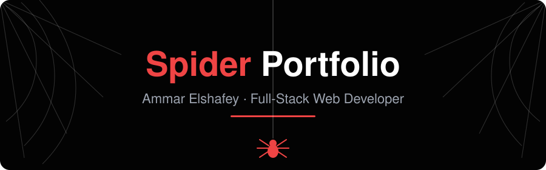

<div align="center">



<br/>

<a href="https://github.com/AmmarElshafey">
  
</a>

<br/><br/>


<br/>

<a href="https://ammar-spiderportfolio.vercel.app/">
  
</a>

</div>

---

## 🕸️ What is this?

A modern, interactive Personal Portfolio. It shows **who I am**, **what I've built**, and lets visitors **reach me**. Dark look, smooth animations, and custom 3D visual effects 😎

---

## ✨ Cool Stuff Inside

| | Feature | What it does |
|---|---|---|
| 🎭 | **3D Hero** | Reacts to your mouse |
| 🧭 | **Smart Navbar** | Smooth scrolling + glow + mobile menu |
| 🃏 | **Project Cards** | Tilt and glow when you hover |
| 🎬 | **Scroll Animations** | Sections slide in as you scroll |
| 📬 | **Contact Form** | Send me a message directly |
| 📱 | **Responsive** | Looks great on any screen |

---

## 🧰 Built With

<div align="center">


</div>


| Tool | Used for |
|---|---|
| ⚛️ React 19 | Building the interface |
| ⚡ Vite | Fast dev server and build |
| 🎨 Tailwind CSS 4 | Styling |
| 🎞️ GSAP | Animations |
| 🧊 Three.js + GLSL | 3D effect |
| 📮 Formspree | Contact form |

---

## 🗂️ Folder Map

```
spider-portfolio/
├── public/
│   └── favicon.svg
├── src/
│   ├── assets/
│   │   ├── man/
│   │   └── spiderman/
│   ├── components/
│   │   ├── Navbar.jsx
│   │   ├── Hero.jsx
│   │   ├── HeroShaders.js
│   │   ├── About.jsx
│   │   ├── Projects.jsx
│   │   ├── Contact.jsx
│   │   └── Footer.jsx
│   ├── App.jsx
│   ├── index.css
│   └── main.jsx
├── index.html
├── package.json
├── vite.config.js
└── eslint.config.js
```

---

## 📬 Let's Connect

<div align="center">

[](https://ammar-spiderportfolio.vercel.app/)
[](https://github.com/AmmarElshafey)
[](https://www.linkedin.com/in/ammar-elshafey/)
[](mailto:ammarsaidelshafey@gmail.com)

<br/>

**Thanks for stopping by! If you like it, drop a ⭐ and swing back anytime.** 🕷️


</div>
